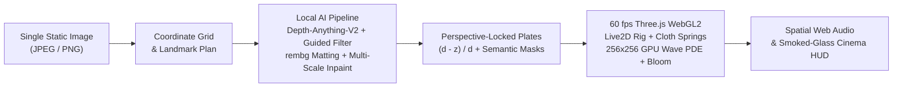

# Living Frame

> Turn any single static image into an interactive **60 fps 2.5D living WebGL2 diorama**—powered by local AI depth estimation, perspective-locked parallax plates, hidden-background inpainting, semantic pixel stencils, custom GLSL shaders, tactile physics, and zero-asset procedural spatial Web Audio.

[](./LICENSE)
[](https://skills.sh)
[](https://threejs.org)

No AI video generation. No looping MP4s. No cloud rendering costs. No external audio files.

---

## Install

Install directly with the [Skills CLI](https://skills.sh) (`npx skills`)—works with **Antigravity, Claude Code, Cursor, Codex, Windsurf, OpenCode**, and other Agent Skills-compatible tools:

```bash
# Install into your current project
npx skills add ifalfahri/living-frame

# Or install globally across all projects
npx skills add ifalfahri/living-frame -g -y
```

### Manual Installation (Antigravity / Local)

```bash
git clone https://github.com/ifalfahri/living-frame.git ~/.gemini/config/skills/living-frame
```

---

## Usage

Once installed, drop any static image (anime scene, game splash art, illustration, cyberpunk alley, portrait, or landscape) into your AI coding agent and ask:

- *"Use the `living-frame` skill to turn this image into an interactive 2.5D WebGL2 diorama."*
- *"Animate `hero.jpg` into a 60 fps living frame with parallax, blinking, cloth wind, glowing effects, and spatial audio."*
- *"Create a living 2.5D diorama from `./artwork.png` with Before/After split compare and a layer inspector."*

---

## How It Works



### Pipeline Highlights

| Stage | What It Builds |
| :--- | :--- |
| **1. Landmark Grid** | Generates a `0.0–1.0` coordinate grid (`scripts/grid_overlay.py`) so every eye socket, pivot, light source, cloth root, and cutout polygon is measured—never guessed. |
| **2. Local AI Depth & Plates** | Runs `Depth-Anything-V2` locally (Apple Silicon MPS / CUDA / CPU) + OpenCV RGB-guided edge filtering + `rembg` (`isnet-general-use`) + 14 px RGB edge-bleed dilation + multi-scale Telea backdrop inpainting (`scripts/pipeline_template.py`). |
| **3. Color-True WebGL2 Engine** | Perspective-locked depth cards scaled by exact `(d - z) / d` with `SRGBColorSpace` + `NoToneMapping`, 5-tap neighborhood-clamped CAS sharpening, `128×72` Live2D breathing/head-pivot/gaze/3-stage blinking, tactile cloth springs, and selective multi-mask bloom. |
| **4. GPU Wave PDE & Particles** | Real-time `256×256` `HalfFloatType` ping-pong 2D wave solver with reflective Neumann boundaries (puddle ripples, water reflections, or arcane air distortion) + depth-stratified GPU particles with cursor swirl. |
| **5. Spatial Audio & Cinema HUD** | 100% Web Audio API stereo soundscape linked to camera parallax, draggable smoked-glass HUD (double-click header to snap back) with 4 mood presets, 5 atmosphere sliders, draggable **Before/After Split-Compare Curtain** (`C`), 6-mode **Layer & Mask Inspector** (`D`), and mobile bottom-sheet support. |

---

## Interactive Controls & Shortcuts

Every generated diorama includes:

- **Direct Canvas Toys:** Drag to steer parallax, scroll to zoom (`1.0×–1.18×`), swipe cloth/curtains, click glowing elements to spark/surge, and drag across interactive ripple zones.
- **Keyboard Shortcuts:**
  - `C` — Toggle draggable Before/After Split-Compare curtain (Original JPEG vs. Live 2.5D)
  - `D` — Open 6-mode Render Pass & Layer Inspector (`Final`, `No-Post`, `Depth`, `Masks`, `Emissive`, `Original`)
  - `Space` — Pause / resume simulation
  - `M` — Toggle procedural spatial Web Audio
  - `H` — Hide / restore HUD

---

## Requirements (When Running the Skill)

- **Node.js 20+** (`npm` / Vite / Three.js)
- **Python 3.12+** (`uv` recommended) for local offline depth & matting (`torch`, `transformers`, `rembg`, `onnxruntime`, `opencv-python-headless`, `scipy`, `pillow`)
- Runs 100% locally on Apple Silicon (MPS), NVIDIA GPU (CUDA), or CPU—zero paid video APIs required.

---

## Repository Structure

```text
living-frame/
├── SKILL.md                         # Main agent skill instructions & 6-phase workflow
├── README.md                        # Documentation & installation guide
├── LICENSE                          # MIT License
├── scripts/
│   ├── grid_overlay.py              # Draws normalized 0.0–1.0 coordinate grid on any image
│   └── pipeline_template.py         # Reusable local AI depth, matting, edge-bleed & inpaint script
└── references/
    ├── shaders-and-optics.md        # Perspective math, CAS, Live2D rig, GPU wave PDE & split-compare GLSL
    ├── audio-and-hud.md             # Zero-asset spatial Web Audio & smoked-glass HUD spec
    └── scene-archetypes.md          # Adaptation guide (neon alleys, fantasy splash art, landscapes, interiors)
```

---

## Credits & Inspiration

This skill is directly inspired by and adapted from the extraordinary engineering breakdown of:

- **[Shinya Ramen (深夜ラーメン) · 2.5D Diorama](https://ashutoshai.com/showcase/d/shinya-ramen)** by **Ashutosh Shrivastava** ([ashutoshai.com](https://ashutoshai.com/) · [@ai_for_success](https://x.com/ai_for_success)) — which pioneered this exact single-JPEG → local `Depth-Anything-V2` + guided filtering + multi-plate inpainting + packed RGB semantic stencils + color-true Three.js WebGL2 Live2D / GPU ping-pong PDE / procedural spatial Web Audio / Split-Compare Inspector architecture.

Built on top of open-source foundations:
- [Depth Anything V2](https://github.com/DepthAnything/Depth-Anything-V2)
- [rembg / IS-Net](https://github.com/danielgatis/rembg)
- [Three.js](https://threejs.org/)
- [OpenCV](https://opencv.org/) & [SciPy](https://scipy.org/)
- [Vercel Labs Skills CLI (`npx skills`)](https://skills.sh/)

---

## License

[MIT](./LICENSE) © [ifalfahri](https://github.com/ifalfahri)
